<!-- ========================================================= -->
<!--                          HERO                             -->
<!-- ========================================================= -->

  

  
  
  
  
  

<!-- ========================================================= -->
<!--                          ABOUT                            -->
<!-- ========================================================= -->

<table align="center" width="96%">
<tr>
<td valign="top">

<h2>Where business meets build</h2>

I'm a <strong>final-year Software Engineering undergraduate at SLTC</strong> who sits
between the people with the problem and the people writing the code. I gather
requirements, model the process, sketch the experience — and then help build it.

I've coordinated teams of four and five across research, ML and product work,
led events as <strong>Vice-Chairperson of the IEEE Computer Society Student Branch Chapter</strong>,
and run my own AI fashion platform, <a href="https://pixlore-web.vercel.app/"><strong>Pixlore AI Studio</strong></a>,
from concept to launch.

<table>
<tr>
<td><strong>Analyze</strong> Requirements · Process modeling · BABOK · Agile/Scrum</td>
<td><strong>Insight</strong> Power BI · SQL · Excel · Python analytics</td>
</tr>
<tr>
<td><strong>Design</strong> Figma · User research · Wireframes · Prototypes</td>
<td><strong>Generate</strong> ComfyUI · Flux · Kling AI · Gemini · Claude Code</td>
</tr>
</table>

📍 Matale, Sri Lanka &nbsp;·&nbsp; 🎯 Open to Business Analyst, Product &amp; UI/UX roles 
<em>Fun fact: I write the user story before I write the code — and I mean it.</em>

</td>
</tr>
</table>

<!-- ========================================================= -->
<!--                        PROCESS                            -->
<!-- ========================================================= -->

  

<!-- ========================================================= -->
<!--                         TOOLKIT                           -->
<!-- ========================================================= -->

  

<!-- ========================================================= -->
<!--                      FEATURED WORK                        -->
<!-- ========================================================= -->

<h2 align="center"><code>// 03</code> Featured Work</h2>

<table align="center" width="96%">
<tr>
<td colspan="2" valign="top">
<h3>🧠 CogniGuide &nbsp;<code>FINAL YEAR PROJECT · ONGOING</code></h3>
Flutter · Python (Flask) · Supabase · OpenAI · Gemini

A metacognition-oriented AI agent that uses Socratic dialogue to build critical thinking in teenagers instead of handing them answers. Leading planning and coordination for a four-member research team across a three-phase, mixed-methods study.

</td>
</tr>
<tr>
<td width="50%" valign="top">
<h3>🏥 SmartCare</h3>
Python · XGBoost · SHAP · Streamlit

Predicts 30-day hospital readmission with explainable ML — <b>ROC-AUC 0.942</b> and <b>100% recall</b>.

<a href="https://github.com/omega-u20/SmartCare-HospitalManagement"><b>Codebase →</b></a>
</td>
<td width="50%" valign="top">
<h3>✨ Pixlore AI Studio</h3>
React 19 · Vite · TypeScript · Tailwind

My commercial AI fashion &amp; creative platform — custom generation workflows and package licensing, planned and shipped solo.

<a href="https://pixlore-web.vercel.app/"><b>Live site →</b></a>
</td>
</tr>
<tr>
<td width="50%" valign="top">
<h3>🕸️ OGBN-Arxiv GNN</h3>
PyTorch · PyG · Streamlit

GCN &amp; GAT node classification across a 169K-paper citation graph, with an explainability dashboard.

<a href="https://github.com/geeth-rp/CCS4354-OGBN-Arxiv-GNN"><b>Codebase →</b></a>
</td>
<td width="50%" valign="top">
<h3>🏙️ Utopia</h3>
Flutter · React · Node.js · Express

Smart-town platform: incident tracking, payments and geospatial services across mobile and web.

<a href="https://github.com/omega-u20/utopia"><b>Codebase →</b></a>
</td>
</tr>
</table>

<!-- ========================================================= -->
<!--                         TIMELINE                          -->
<!-- ========================================================= -->

  

<b>Certifications &amp; leadership</b>

 

| | Credential | Issuer | |
| :-: | :-- | :-- | :-: |
| 📊 | Business Analysis Basics | Simplilearn SkillUp | [verify](https://simpli-web.app.link/e/PsqS2x9iK6b) |
| 📈 | Power BI for Beginners | Simplilearn SkillUp | — |
| 🗄️ | SQL (Basic) | HackerRank | [verify](https://www.hackerrank.com/certificates/8d37badcae27) |
| 💻 | Software Engineer Intern | HackerRank | [verify](https://www.hackerrank.com/certificates/3a4c8c02dac8) |
| 🏅 | Certificate of Appreciation — Vice-Chairperson | IEEE CS SBC, SLTC | [verify](https://drive.google.com/file/d/1jLO6BqpjdSUvk0l3no3-NB6fjBd717Ba/view?usp=sharing) |
| 🎫 | IEEE Membership 2026 | IEEE Student Branch of SLTC | [verify](https://drive.google.com/file/d/1td8-l1EJp5S5t-UdjpesT4918HUrOrdX/view?usp=sharing) |

Also: Co-Chair, IEEE Codemania V5.0 · Coordination Head, IEEE Day 2025 · Program Head, Arduino Challenge 2025 / Decode Xtreme 2024 / Git Genius 2024 · Marketing &amp; Promotion Head, Master Designer

<!-- ========================================================= -->
<!--                         ACTIVITY                          -->
<!-- ========================================================= -->

<h2 align="center"><code>// 05</code> Activity</h2>

  
  

  

<!-- ========================================================= -->
<!--                          CONNECT                          -->
<!-- ========================================================= -->

  

  
  
  
   
  

